# GlucoTrack – Blood Glucose Tracker

GlucoTrack is a full-stack blood glucose tracking application that allows users to record, manage and review their glucose readings through a simple and responsive dashboard.

The application supports individual user accounts, secure authentication, glucose reading management and daily/monthly reports.

## Features

### Authentication
- User registration and login.
- Password hashing using bcrypt.
- JWT-based authentication using HttpOnly cookies.
- Protected routes and user-specific data access.
- Logout functionality.

### Glucose Reading Management
- Add, view, edit and delete glucose readings.
- Four daily time slots:
  - Morning fasting
  - After breakfast
  - After lunch
  - After dinner
- Glucose values validated between 40 and 600 mg/dL.
- Whole-number validation.
- Future-date prevention.
- Duplicate reading prevention for the same date and time slot.

### Dashboard
- Monthly average glucose.
- Highest glucose reading.
- Lowest glucose reading.
- Total readings.
- Recent readings.
- Responsive desktop and mobile layout.
- Light and dark themes.

### Reports
- Daily report.
- Month-to-date report.
- Previous-month report.
- High, low, average and total reading statistics.
- Empty states when no readings are available.

## Screenshots

### Desktop View – Dark Theme

**Login**

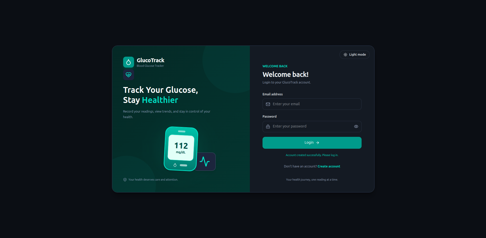

**Register**

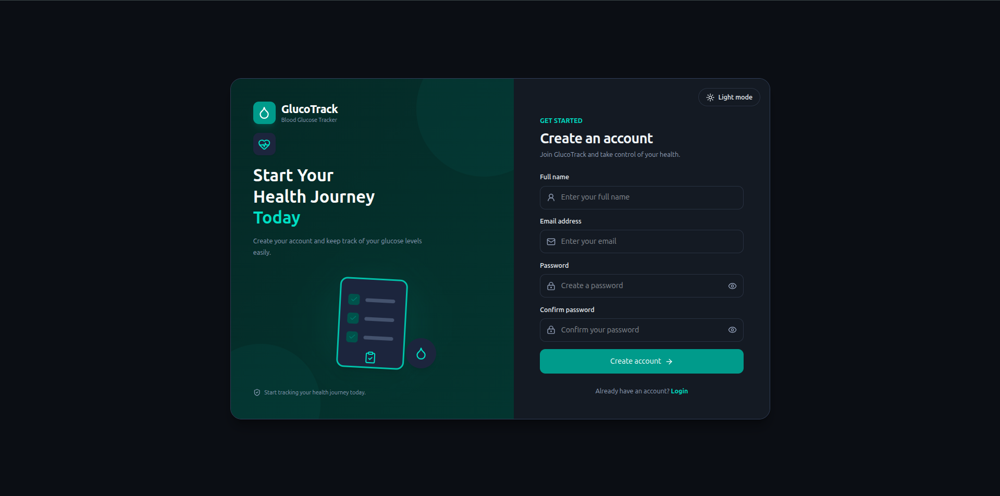

**Dashboard Overview**

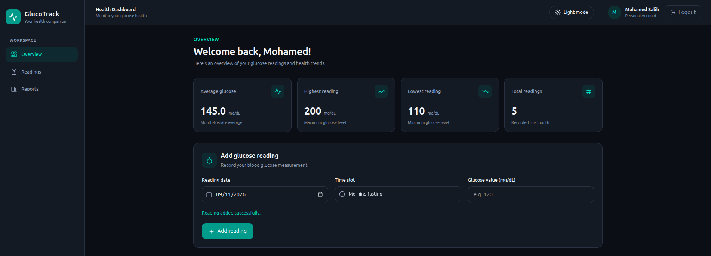

**Readings**

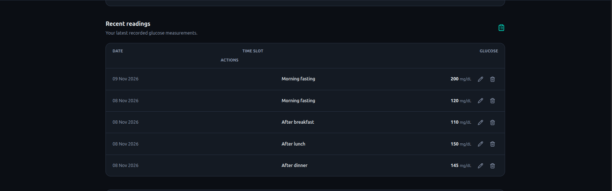

**Reports**

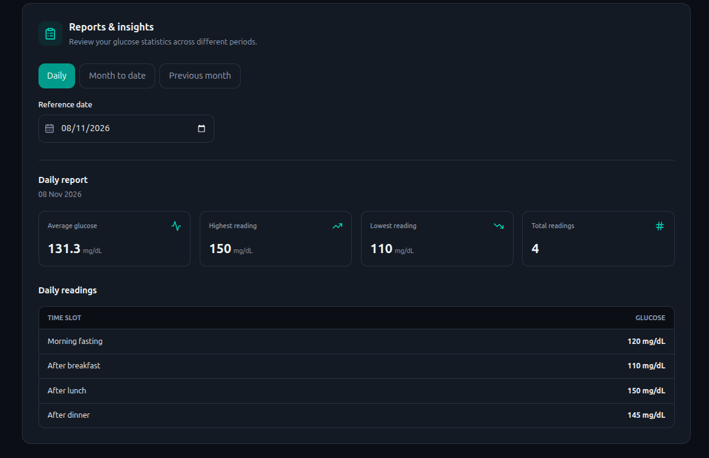

### Mobile View – Light Theme

**Login**

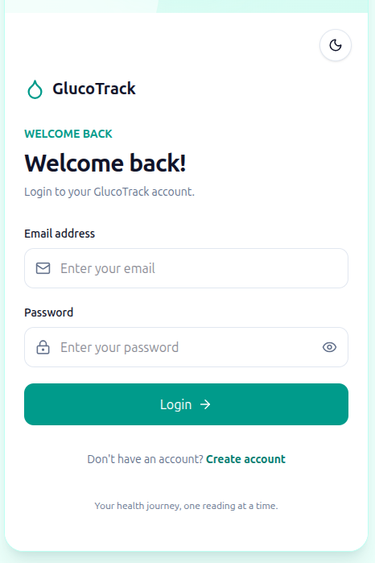

**Register**

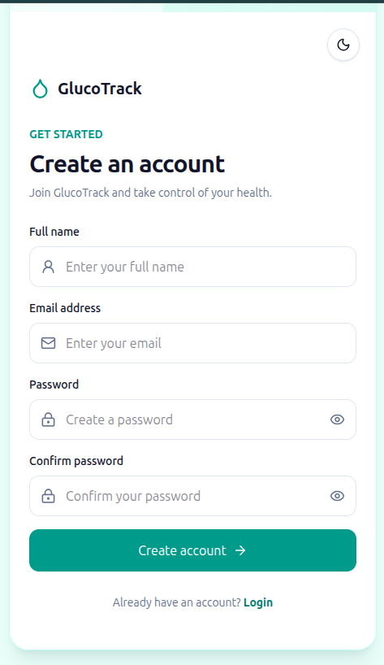

**Dashboard Overview**

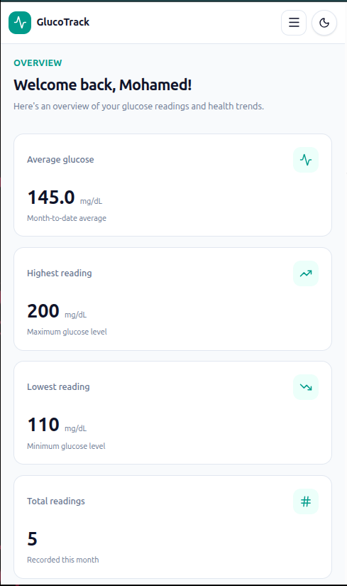

**Readings**

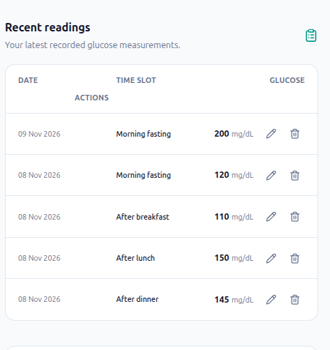

**Add Reading**

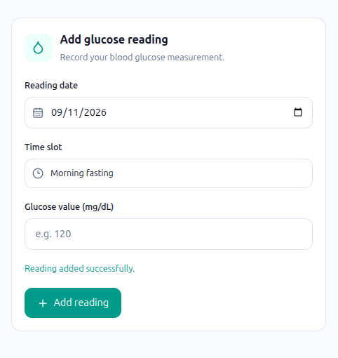

**Reports – Daily and Monthly**

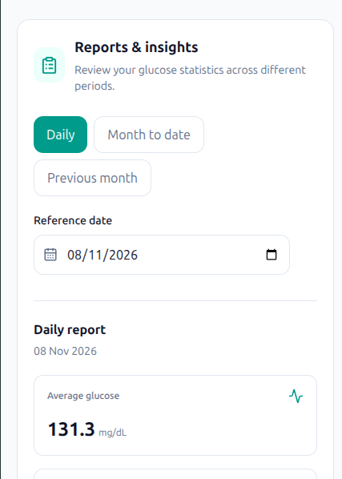

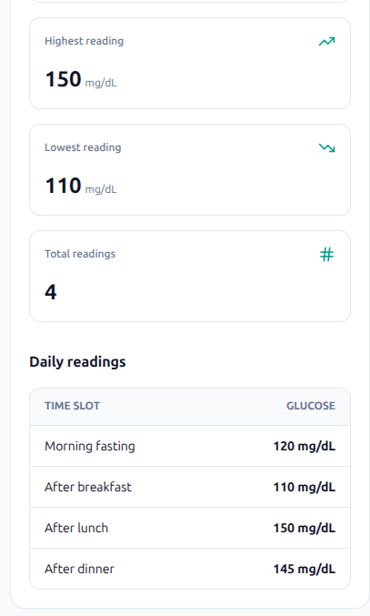

## Technology Stack

**Frontend**
- React
- TypeScript
- Vite
- Tailwind CSS
- React Router
- Lucide React

**Backend**
- Node.js
- Express.js
- PostgreSQL
- pg
- bcrypt
- JSON Web Token
- cookie-parser

## Project Structure

```text
sweety-glucose-tracker/
├── backend/
│   ├── src/
│   │   ├── config/
│   │   ├── controllers/
│   │   ├── middleware/
│   │   ├── routes/
│   │   ├── seed.js
│   │   └── server.js
│   ├── .env.example
│   └── package.json
│
├── database/
│   └── schema.sql
│
├── frontend/
│   ├── src/
│   │   ├── components/
│   │   ├── context/
│   │   ├── pages/
│   │   ├── services/
│   │   └── types/
│   └── package.json
│
├── screenshots/
│   ├── Desktop_View/
│   └── Mobile_view/
│
├── .gitignore
└── README.md
```

## Prerequisites

Make sure the following are installed:

- Node.js
- npm
- PostgreSQL

## Installation and Setup

### 1. Clone the repository

```bash
git clone https://github.com/Salih-111/Sweety-Blood-Glucose-Tracker-.git
cd Sweety-Blood-Glucose-Tracker-
```

### 2. Set up the PostgreSQL database

Open PostgreSQL:

```bash
psql -U postgres
```

Create the database:

```sql
CREATE DATABASE sweety_db;
```

Exit PostgreSQL:

```sql
\q
```

Run the database schema:

```bash
psql -U postgres -d sweety_db -f database/schema.sql
```

### 3. Configure the backend

Navigate to the backend:

```bash
cd backend
```

Install dependencies:

```bash
npm install
```

Create a `.env` file using `.env.example` as a reference.

Configure the following environment variables:

```env
PORT=5000

DB_HOST=localhost
DB_PORT=5432
DB_NAME=sweety_db
DB_USER=postgres
DB_PASSWORD=your_postgres_password

JWT_SECRET=your_secure_random_secret
NODE_ENV=development
```

Use your own PostgreSQL password and a secure random JWT secret. Never commit your actual `.env` file.

### 4. Seed demo data

Run:

```bash
npm run seed
```

This creates or updates the demo account and inserts sample glucose readings.

**Demo credentials**

```text
Email: demo@sweety.com
Password: DemoPass123
```

### 5. Start the backend server

```bash
npm run dev
```

Backend runs at:

```text
http://localhost:5000
```

### 6. Set up the frontend

Open another terminal:

```bash
cd frontend
npm install
npm run dev
```

Frontend runs at:

```text
http://localhost:5173
```

Open the frontend URL in your browser to use GlucoTrack.

## API Endpoints

All endpoints except registration and login require authentication unless otherwise specified.

### Authentication

| Method | Endpoint | Description |
|---|---|---|
| POST | `/api/auth/register` | Register a new user |
| POST | `/api/auth/login` | Login |
| GET | `/api/auth/me` | Get current user |
| POST | `/api/auth/logout` | Logout |

### Glucose Readings

| Method | Endpoint | Description |
|---|---|---|
| GET | `/api/readings` | Get all user readings |
| POST | `/api/readings` | Add a reading |
| GET | `/api/readings/:id` | Get a specific reading |
| PUT | `/api/readings/:id` | Update a reading |
| DELETE | `/api/readings/:id` | Delete a reading |

### Reports

| Method | Endpoint | Description |
|---|---|---|
| GET | `/api/reports/daily?date=YYYY-MM-DD` | Daily report |
| GET | `/api/reports/month-to-date?date=YYYY-MM-DD` | Month-to-date report |
| GET | `/api/reports/previous-month?date=YYYY-MM-DD` | Previous-month report |

## Validation Rules

- Glucose values must be whole numbers between 40 and 600 mg/dL.
- Only the four supported time slots are accepted.
- Future reading dates are not allowed.
- A user cannot record more than one reading for the same date and time slot.
- Users can access and manage only their own readings.

## Testing

The following functionality has been manually tested:

- User registration and login.
- Invalid login credentials.
- Session persistence after page refresh.
- Logout and protected route access.
- User data isolation across accounts.
- Adding, editing and deleting readings.
- Duplicate reading prevention.
- Glucose value validation.
- Future-date validation.
- Daily, month-to-date and previous-month reports.
- Empty report states.
- Responsive layout and theme switching.

The frontend production build was also checked using:

```bash
npm run build
```

## Assumptions and Future Improvements

### Assumptions
- Glucose readings are recorded in mg/dL.
- Each user manages an individual account.
- A maximum of four readings can be recorded per day, one per supported time slot.
- Reading dates cannot be in the future.

### Future Improvements
- Glucose trend charts and visual analytics.
- Export reports as PDF.
- Notifications and reminders for recording readings.
- More detailed historical comparisons.
- Improved accessibility and additional automated tests.

## Note

GlucoTrack is a personal glucose tracking application intended for recording and reviewing measurements. It is not a replacement for professional medical advice or diagnosis.

## Author

Mohamed Salih